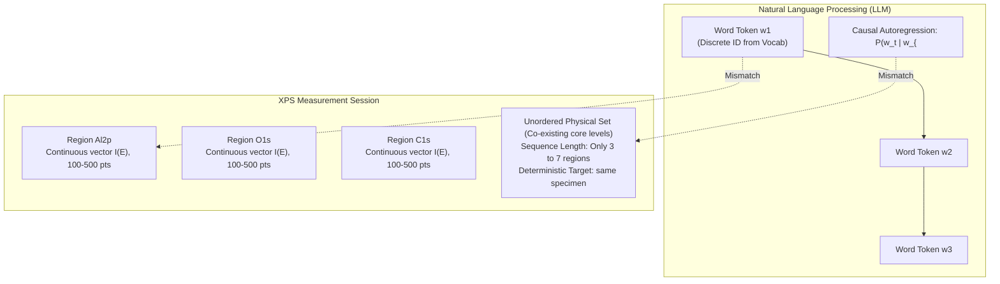
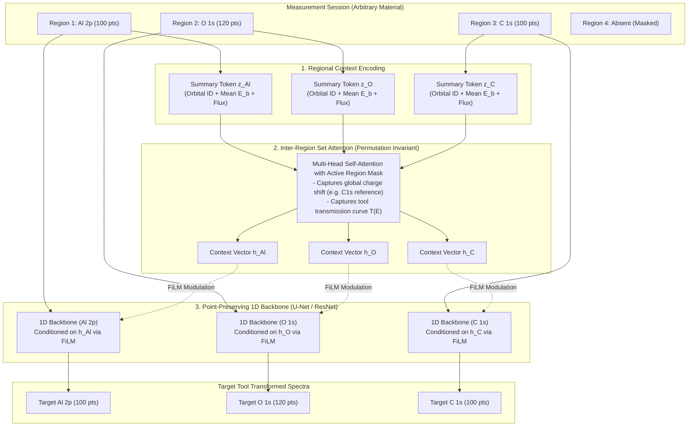

# XPS Spectral Transformation: Architectural Evaluation & Transformer Plan

## [Goal Description]
The user is exploring a architectural paradigm shift: treating each regional spectrum as a "word" in a "sentence" (LLM / Transformer sequence-to-sequence style) to transform source-tool spectra to target-tool spectra across multiple materials. 

In real-world XPS characterization:
- Different materials contain different chemical elements and orbitals (e.g., $\text{Al}_2\text{O}_3$ has $\text{Al } 2p, \text{O } 1s, \text{C } 1s$; $\text{TiN}$ has $\text{Ti } 2p, \text{N } 1s, \text{C } 1s$).
- For certain materials, specific regional spectra are completely non-existent (no signal or not acquired).
- The model must handle flexible input and output sets of regional spectra without requiring a rigid, fixed list of regions or separate models trained in isolation.

This document analyzes the critical flaws of a direct LLM-style translation model, compares alternative architectures, and proposes a physics-grounded **Hierarchical Set-Conditioned Spectral Transformer (HSC-ST)** that achieves full multi-material flexibility while maintaining high-fidelity physical spectral shapes.

---

## Architectural Evaluation: Critical Flaws of Direct "LLM / Word" Analogy

While the motivation for handling dynamic, variable sets of regions across materials is essential, treating regional spectra directly as "words in an autoregressive sentence" introduces four fundamental physical and mathematical flaws:



### 1. Continuous High-Dimensional Vectors vs. Discrete Vocabulary
- **LLM Reality**: Words are discrete categorical tokens mapped to a finite dictionary ($V \approx 32\text{k}-100\text{k}$). The decoder outputs cross-entropy classification over $V$.
- **XPS Reality**: A regional spectrum is a continuous 1D physical curve $I(E)$ over $N_{points} \in [100, 1000]$ at sub-eV energy resolutions.
- **The Bottleneck**: Compressing a 100-point spectrum into a single token embedding vector $\mathbf{z} \in \mathbb{R}^D$ and attempting to decode it back introduces severe information loss:
  - Loss of chemical shifts ($\sim 0.1\text{ eV}$) indicating oxidation states.
  - Blurring of doublet spin-orbit splitting ($2p_{3/2}$ vs $2p_{1/2}$) and asymmetric Doniach-Šunjić peak shapes.
  - Inaccurate background step levels (Shirley/Tougaard backgrounds).

### 2. Autoregressive Causal Order vs. Unordered Physical Set
- **LLM Reality**: Language is inherently sequential and directional (word 1 $\to$ word 2 $\to$ word 3).
- **XPS Reality**: Regional core levels on a specimen are an **unordered physical set** $\mathcal{R} = \{\text{Al } 2p, \text{O } 1s, \text{C } 1s\}$. $\text{Al } 2p$ does not "cause" or sequentially precede $\text{O } 1s$.
- **The Pitfall**: An autoregressive decoder imposes an artificial sequence order, risks hallucinating regions that do not exist in the specimen, or prematurely generating an `[EOS]` token and skipping real regions.

### 3. Severe Overfitting on Tiny Sequence Lengths ($L \approx 3 - 7$)
- **LLM Reality**: Self-attention shines on sequences of hundreds or thousands of tokens with billions of training examples.
- **XPS Reality**: A single measurement session has only **3 to 7 regions**. Applying standard dense multi-head self-attention and cross-attention blocks to sequences of length $L \le 7$ across modest experimental dataset sizes ($10^2 - 10^4$ measurements) leads to extreme parameter redundancy, attention weight collapse, and overfitting.

### 4. Deterministic 1-to-1 Specimen Identity Across Tools
- The source tool and target tool measure the **exact same physical specimen**.
- If the specimen placed into Tool J4 has regions $\{\text{Al } 2p, \text{O } 1s, \text{C } 1s\}$, the expected target spectra on Tool J5 are *strictly and deterministically* $\{\text{Al } 2p, \text{O } 1s, \text{C } 1s\}$. The model should not be predicting *which* regions exist; it only needs to transform the spectra of the regions that were actually scanned.

---

## Comparison of Alternative Architectural Paradigms

| Dimension | Option 1: Naive Autoregressive LLM (Region as Word) | Option 2: Hierarchical Set-Conditioned Transformer (HSC-ST) [Recommended] | Option 3: Continuous Energy Patch Transformer (PatchTST / ViT style) | Option 4: Universal 1D Backbone with FiLM Conditioning |
| :--- | :--- | :--- | :--- | :--- |
| **Token Representation** | 1 Regional spectrum = 1 token vector | Dual-scale: 1D Conv features per point + Set Token per region | Energy bins / patches along eV grid = tokens | Point-level 1D Conv with Orbital & Tool Embeddings |
| **Multi-Material Flexibility** | High (variable length) | **High (permutation-invariant set masking)** | High (continuous energy coordinate) | **High (dispatches any region dynamically)** |
| **Spectral Fidelity (FWHM, doublets)** | Low (bottlenecked vector decoding) | **Highest (preserves exact 1D point resolution via U-Net/ResNet)** | Medium-High (local patch reconstruction) | **Highest (direct 1D sequence mapping)** |
| **Cross-Region Physics** | Autoregressive attention | **Set Attention (bidirectional cross-talk for charging & transmission)** | Global Self-Attention | Implicit (via global flux / metadata features) |
| **Risk of Hallucination** | High (can generate wrong regions) | **Zero (strictly conditioned on present regions)** | Zero (operates on energy grid) | **Zero (1-to-1 regional mapping)** |
| **Training Stability & Sample Efficiency** | Poor ($L \le 7$, large parameter count) | **Excellent (modular loss, pre-trainable backbones)** | Moderate (requires large patch dataset) | **Highest (fastest convergence, fewest parameters)** |

---

## Recommended Architecture: Hierarchical Set-Conditioned Spectral Transformer (HSC-ST)

Instead of forcing continuous spectra into text tokens, the **Hierarchical Set-Conditioned Spectral Transformer** decouples the problem into two complementary physical scales:
1. **Intra-Region Micro-Scale (Continuous Signal Transformation)**: A 1D convolutional backbone (Residual U-Net / ResNet) operates directly on the point-by-point spectral intensity $I(E)$, preserving peak positions, line shapes, and sequence length.
2. **Inter-Region Macro-Scale (Measurement Context & Set Attention)**: A lightweight **Set Attention Transformer** operates on summary embeddings of whatever regions are present in that specific measurement session.



### Why this solves your exact multi-material requirement:
- **Variable Number & Types of Regions**: A measurement with 2 regions (e.g. $\text{C } 1s, \text{O } 1s$) or 6 regions (e.g. $\text{Ti } 2p, \text{Al } 2p, \text{N } 1s, \text{O } 1s, \text{C } 1s, \text{Cl } 2p$) simply passes its active regions into the Set Attention block. An attention mask suppresses any non-existent regions.
- **Physical Cross-Region Intelligence**: In XPS, spectroscopists use the $\text{C } 1s$ peak ($284.8\text{ eV}$) to calibrate surface charging for all other peaks. The Set Attention mechanism automatically learns this physical coupling across regions.
- **Preserved Point-by-Point Accuracy**: Because the spectra are transformed through 1D convolutional layers with identity shortcuts ($y = x + \Delta(x)$), high-resolution physical peak characteristics are never blurred by a low-dimensional bottleneck.

---

## User Review Required

> [!IMPORTANT]
> **Key Design Decision on Output Scope**:
> In your request, you noted: *"Similar situation also occurs in the output: some regional spectra may not even be there for certain materials."*
> **Question**: Do you want the model to:
> 1. **Transform only what was scanned** (i.e., if Source Tool scanned regions $\{A, B\}$, Target Tool output is $\{A', B'\}$)?
> 2. **Cross-synthesize missing regions** (i.e., if Source Tool only scanned $\{A\}$, can the model be queried to hallucinate/predict an unmeasured $\{B\}$ on the Target Tool)?
> *(In XPS physics, Option 1 is standard, physically well-posed, and strictly deterministic. Option 2 is ill-posed unless the material's stoichiometry is strictly fixed and known).*

> [!WARNING]
> **Data Pipeline Impact**:
> Currently, `utility/splitting.py`, `models/dataset.py`, and `models/orchestration.py` process data on a per-region partition (independent datasets for `Al2p`, `Ti2p`, etc.).
> Supporting multi-material sessions requires introducing a **Measurement Session Dataset** that collates variable regional spectra per measurement ID with padding masks.

---

## Open Questions

1. **Material Metadata**: Does the dataset have a designated `material` column in `df_meta` (e.g., `'NMG'`, `'SiO2'`, `'TiN'`), and should the material ID or composition be an explicit conditioning feature?
2. **Regional Energy Grids**: Across different materials, does a given region (e.g., $\text{O } 1s$) always have the same energy step ($\Delta E$) and point count ($N$), or can point counts vary dynamically between measurement recipes?
3. **Sliding Window vs. Full Spectrum**: Sliding window (patching) is currently supported in `models/dataset.py`. For multi-region attention, do you prefer operating on full regional spectra or patched windows?

---

## Proposed Changes & Roadmap

If approved to proceed with the **Hierarchical Set-Conditioned Spectral Transformer (HSC-ST)**, implementation will follow these modular stages:

### Phase 1: Measurement Session Dataset & Masking (`models/dataset.py`)
- [NEW] `MeasurementSessionDataset`: Groups all regional spectra belonging to a single measurement session `(source_measurement_id, target_measurement_id)`.
- Implements dynamic collation with a boolean mask `region_mask` indicating which regions are present for that material.
- Packages regional intensities, binding energy vectors, orbital IDs, and session metadata into batched tensors of shape $(B, R_{max}, 1, L)$ and $(B, R_{max})$.

### Phase 2: Set-Attention Conditioning Module (`models/set_transformer.py`)
- [NEW] `RegionSetAttention`: Permutation-invariant multi-head self-attention operating over regional summary tokens.
- Encodes:
  - Categorical Orbital ID (e.g., `Al2p`, `Ti2p`, `O1s`).
  - Regional binding energy center $E_0$ and range $\Delta E$.
  - Regional integrated flux and relative intensity.
  - Tool metadata (time, tool ID, die index).
- Outputs conditioned regional vectors $\mathbf{h}_r$ for each active region.

### Phase 3: Conditioned 1D Spectral Backbone (`models/transformer_backbone.py` or `models/layers.py`)
- Integrates FiLM modulation from $\mathbf{h}_r$ into the 1D ResNet / Residual U-Net backbones.
- Ensures sequence length preservation, mirror padding, and identity shortcut ($y = x + \Delta(x)$).

### Phase 4: Mask-Aware Multi-Region Loss (`models/cost.py`)
- Updates `SpectralLoss` to accept masked batches:
  $$\mathcal{L} = \frac{\sum_{r \in \mathcal{R}_{active}} w_r \mathcal{L}_r(I_{pred}^{(r)}, I_{target}^{(r)})}{\sum_{r \in \mathcal{R}_{active}} w_r}$$
- Completely ignores missing regions during backpropagation.

### Phase 5: Pipeline Orchestration & Main Script (`models/orchestration.py`, `main.py`)
- Adds joint multi-region training mode alongside the existing per-region training mode.
- Enables Ax Bayesian optimization for transformer hyperparameters (embedding dimensions, attention heads, dropout, backbone channels).

---

## Verification Plan

### Automated Tests
1. **Masked Collation Test**:
   ```powershell
   \.venv\Scripts\python.exe -m unittest tests/test_session_dataset.py
   ```
   Verify batches with mixed materials (e.g., Sample 1 with 3 regions, Sample 2 with 5 regions) correctly mask inactive positions.
2. **Permutation Invariance Test**:
   ```powershell
   \.venv\Scripts\python.exe -m unittest tests/test_set_transformer.py
   ```
   Verify that shuffling the order of input regions in a measurement yields identical predictions.
3. **End-to-End Joint Training Test**:
   ```powershell
   \.venv\Scripts\python.exe -m unittest tests/test_orchestration.py
   ```
   Verify convergence and loss backpropagation across multi-material datasets without dimension mismatches or NaNs.

### Manual Verification
- Run `main.py --no-plots` to confirm full training, prediction, and quantification pipeline execution across multi-material pseudo-data.
- Inspect peak preservation, FWHM, and chemical shift fidelity on held-out test splits.
